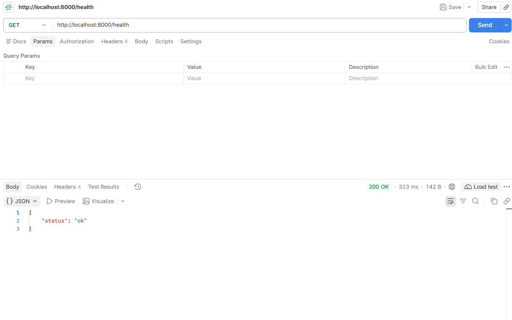

# Docker Demo – FastAPI Health Check

A simple Python API built using FastAPI and Docker.

## Requirements
- Docker Desktop
- Docker Compose

## Project Structure
- `main.py` – FastAPI application
- `requirements.txt` – Python dependencies
- `Dockerfile` – Docker image configuration
- `docker-compose.yml` – Docker Compose configuration
- `postman-screenshot.png` – Postman test screenshot

## How to Run

1. Clone the repository.
2. Open the project folder in the terminal.
3. Run:

```bash
docker compose up
```

4. Open this URL in your browser or Postman:

`http://localhost:8000/health`

## Expected Response

```json
{
  "status": "ok"
}
```

## Stop the Application

Press `Ctrl + C` in the terminal, or run:

```bash
docker compose down
```

## Postman Test

The GET `/health` endpoint was tested successfully in Postman with a `200 OK` response.

## Postman Screenshot

